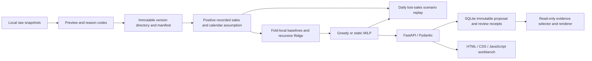

# Architecture

The backend serves the maintainable zero-build frontend, so one process and one origin suffice. Modules separate ingestion, research, allocation, replay, storage and assistant. `main.dataset` caches at most four versions keyed by path and CSV/metadata modification times. The first load verifies the SHA-256 sidecar. Only static assets are mounted; raw snapshots and databases are not web roots.

`POST /api/plans` validates assumptions, checks products, forecasts lead plus review horizon, allocates integer lots, snapshots inputs/provenance/results, hashes sorted JSON, and inserts within a transaction. An optional Idempotency-Key binds concurrent retries to the same fingerprint and run. A reused key with different inputs returns 409. Review challenge preview contains exact saved JSON. Confirmation checks expiry, one-time use, current data hash, latest persisted assumptions hash and snapshot integrity under BEGIN IMMEDIATE. Receipt and token consumption commit together. SQLite file owners can edit everything; there is no authenticated identity assurance.

Data publication builds a hidden staging directory with canonical CSV, metadata, quarantine, raw snapshot and manifest, then renames it on the same filesystem. Registry enumeration ignores staging. This is atomic visibility, not a guarantee against power-loss without filesystem durability. Unique version directories avoid overwriting datasets.

## Added components

app/analytics.py builds a separate read-only-queryable SQL mart from verified canonical data through the development cutoff. mart_runs identifies source/cutoff; dim_product, fact_transaction and fact_daily_sales separate grains. A single write transaction includes source run, facts, calendar rows and reconciliation; duplicate/concurrent loads return the same immutable identity. /api/analytics exposes fixed parameterized reports only.

app/statistics.py provides extended historical folds, strict cohort pairing, circular temporal block resampling and common-seed policy summaries. scripts/robustness.py enforces source stability during execution and verifies the original final evidence is unchanged. /api/research/robustness exposes compact saved summaries with active-dataset mismatch flags. scripts/report_robustness.py generates the research report and standalone scientific figure. See RESEARCH_EXTENSION_REPORT.md for the post-final exploratory boundary.
