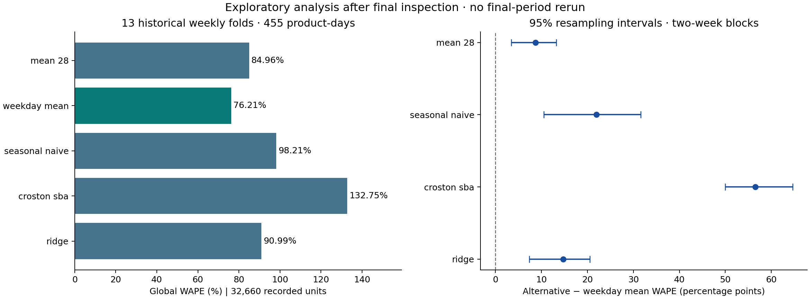

# Exploratory research extension: forecasts, decisions and uncertainty

This extension was specified on 2026-11-21 **after the original final result had been inspected**. It is not new confirmatory holdout evidence. The original protocol, final receipt and result were preserved byte-for-byte; source hashes are recorded in the JSON. No model settings or original final outcomes were changed. The source and algorithm snapshot for the original final evaluation remains in source-at-final.zip.

## Business question and finding

Does better forecasting reliably produce a better purchasing decision? Evidence does not establish a universal relationship. On thirteen historical weekly folds, weekday mean has 16.24% lower absolute error than Ridge. The earlier seven-day final favored seasonal naive, whereas the wider exploratory sample favors weekday mean. This rank instability cautions against selecting a model from one short period. Under tight assumed budgets, the policy and inventory constraints can dominate the forecast difference.

## Historical forecast evaluation

Five fixed methods, five products selected from the first sixty days, thirteen seven-day origins and 455 shared product-days; denominator **32,660 recorded units**. Dates and actual/predicted rows are retained in exploratory-robustness.json. Latest target date: 2011-12-01. First and last cutoffs: 2011-09-01 through 2011-11-24. Zero missing calendar days are an assumption about recorded sales, not unconstrained demand. All methods and losses are retained.

|Method|Absolute error / actual units|WAPE|MAE units|Signed bias units|
|---|---:|---:|---:|---:|
|mean_28|27749.11 / 32660|84.96%|60.99|-494.25|
|weekday_mean|24891.50 / 32660|76.21%|54.71|-1424.00|
|seasonal_naive|32077.00 / 32660|98.21%|70.50|-703.00|
|croston_sba|43356.59 / 32660|132.75%|95.29|15545.56|
|ridge|29716.82 / 32660|90.99%|65.31|5032.11|

## Paired temporal resampling

Each weekly block keeps all products together. Circular fixed-length blocks resample neighboring weeks and wrap the end of the historical sample to its start. Each replicate recomputes both absolute error and actual-unit denominator. With two-week blocks, Ridge-minus-weekday WAPE is +14.77 percentage points; the approximate percentile interval is [7.39, 20.51]. Negative differences favor the alternative; positive differences favor weekday mean. All 2,000 ratio replicates had defined denominators in this actual run.

|Alternative vs weekday mean|WAPE difference (pp)|95% resampling interval (pp)|Block length (weeks)|
|---|---:|---:|---:|
|mean_28|8.75|[3.73, 13.54]|1|
|mean_28|8.75|[3.48, 13.26]|2|
|mean_28|8.75|[3.61, 13.35]|3|
|seasonal_naive|22.00|[10.26, 33.09]|1|
|seasonal_naive|22.00|[10.57, 31.57]|2|
|seasonal_naive|22.00|[12.03, 29.27]|3|
|croston_sba|56.54|[49.53, 64.66]|1|
|croston_sba|56.54|[49.94, 64.60]|2|
|croston_sba|56.54|[49.33, 64.03]|3|
|ridge|14.77|[7.36, 22.55]|1|
|ridge|14.77|[7.39, 20.51]|2|
|ridge|14.77|[7.22, 20.35]|3|

The point estimate is the observed finite-sample difference. The interval is conditional on a small, selected, temporally dependent historical sample and block-resampling assumptions. Thirteen weeks are few; circular boundaries are artificial, longer dependence/nonstationarity can invalidate inference, and multiple comparisons were not adjusted. A nonzero interval is not proof of universal model superiority. One-, two- and three-week intervals are all reported rather than selecting the most favorable one. This is not an independent confirmation after final inspection.

Method context: the [arch project's time-series bootstrap documentation](https://bashtage.github.io/arch/doc/bootstrap/timeseries-bootstraps.html) distinguishes circular fixed-length blocks with wrap-around from ordinary non-wrapping moving blocks. StockFlow implements its bounded NumPy resampling directly; it does not depend on the arch library. See statistics.paired_block_comparison and the sign/denominator/pairing tests.

## Decision robustness under common inputs

Seventy-five replay runs: five forecast methods × three purchasing policies × five seeds (2026–2030). Every seed shares the same exogenous sequence across policies. Seeds vary lead-time jitter only; the same fourteen-day proxy demand totals **4,087 recorded units** in every run. Starting inventory, weekly cash grants and all cost parameters are identical. No revenue, profit or realised savings is estimated.

|Forecast|Policy|Mean scenario cost GBP|Range GBP|Mean unit fill|Cost wins/ties/losses vs weekday greedy|
|---|---|---:|---:|---:|---:|
|croston_sba|fixed|8483.78|8482.20–8486.16|1.47%|0/0/5|
|croston_sba|greedy|8483.78|8482.20–8486.16|1.47%|0/0/5|
|croston_sba|milp|7666.01|7665.27–7667.04|11.16%|4/1/0|
|mean_28|fixed|7667.54|7667.04–7668.14|11.16%|0/5/0|
|mean_28|greedy|7667.54|7667.04–7668.14|11.16%|0/5/0|
|mean_28|milp|7666.01|7665.27–7667.04|11.16%|4/1/0|
|ridge|fixed|8079.28|8078.18–8080.94|6.36%|0/0/5|
|ridge|greedy|8079.28|8078.18–8080.94|6.36%|0/0/5|
|ridge|milp|7666.01|7665.27–7667.04|11.16%|4/1/0|
|seasonal_naive|fixed|7667.54|7667.04–7668.14|11.16%|0/5/0|
|seasonal_naive|greedy|7667.54|7667.04–7668.14|11.16%|0/5/0|
|seasonal_naive|milp|7666.01|7665.27–7667.04|11.16%|4/1/0|
|weekday_mean|fixed|7667.54|7667.04–7668.14|11.16%|0/5/0|
|weekday_mean|greedy|7667.54|7667.04–7668.14|11.16%|0/5/0|
|weekday_mean|milp|7666.01|7665.27–7667.04|11.16%|4/1/0|

Static MILP sometimes reduces hypothetical cost by a small amount while fill rates tie; Ridge/greedy and Croston/greedy lose under the default tight cash regime. This is a narrow static-coverage optimiser, not a dynamic cost optimum. The five seed outcomes are supplier-jitter robustness checks, not independent customer-demand studies. Interpret alongside the eight original one-factor sensitivity regimes in real-development.json. Paid pipeline and terminal inventory remain visible in each daily run.

## SQL evidence and scope

real-analytics-v2.json records the development-only SQL mart: **13,287 loaded canonical lines**, **306,947 positive-sale units**, 142 later canonical lines excluded, and source/cutoff identities. These are five selected products, not a million-row SQL benchmark. The original full-workbook import separately audited 1,067,371 source lines. SQL transaction and calendar totals are reconciled against Python before commit. Canonical row ordinals identify positions in the canonical subset; they are not original Excel row numbers.

Read ANALYTICS_QUERIES.sql for joins, CTEs, window frames, cancellation accounting and development ABC segmentation. A preceding-seven-day window ends at 1 PRECEDING, and zero-filled calendar rows make row counts correspond to days after first sale. ABC uses first-sixty-day units within the subset and is not a profitability classification. Approximate observed sale value is explicitly separated from assumed procurement costs.

## Reproduction and boundaries

Protocol: EXPLORATORY_PROTOCOL_V2.md, SHA-256 `0245b28d9806c0462910b6e28f062abde6ec92e994bf84eb4e931d79757c967f`. Source SHA-256 `63e20d52566ef2b43788518bf4d19a5b7716045c074e428c1c24b7f67770156d`; dataset SHA-256 `41259bd28053720781875d0c8470c115c875f9fd93eb6c71c190f30daa9d4001`. Exact command: `python -m scripts.robustness --data C:\Users\zaman asif\Downloads\StockFlow\StockFlow\data\registry\8ec95337-a8e5-4dbf-a378-7132a5241145\transactions.csv`. Original final hashes before/after are in the JSON. Software/platform versions and UTC timestamp accompany the results.

Run to a new output path to preserve previous exploratory evidence. Do not delete the original FINAL receipt or rerun final evaluation. No new training algorithms, tuned policies or paid model calls were introduced. No research novelty, publication acceptance, production deployment, authenticated purchasing, causal inventory benefit or PhD equivalence is claimed. Independent external data and prospective decisions would be needed for stronger generalisation.
